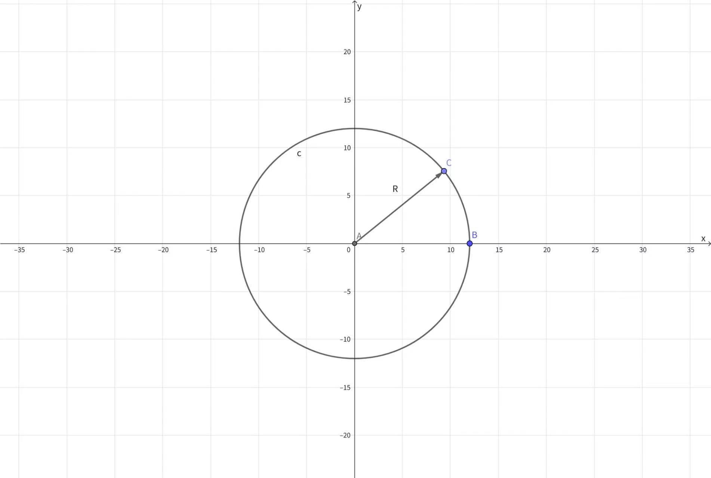
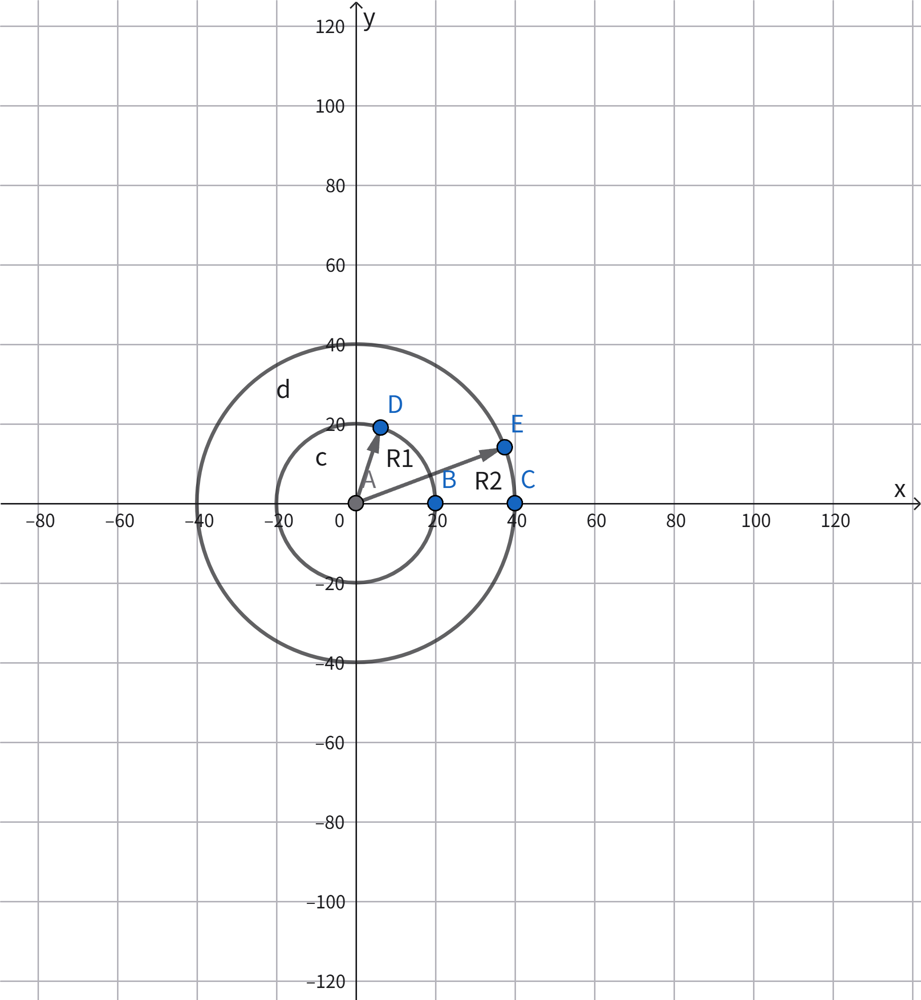
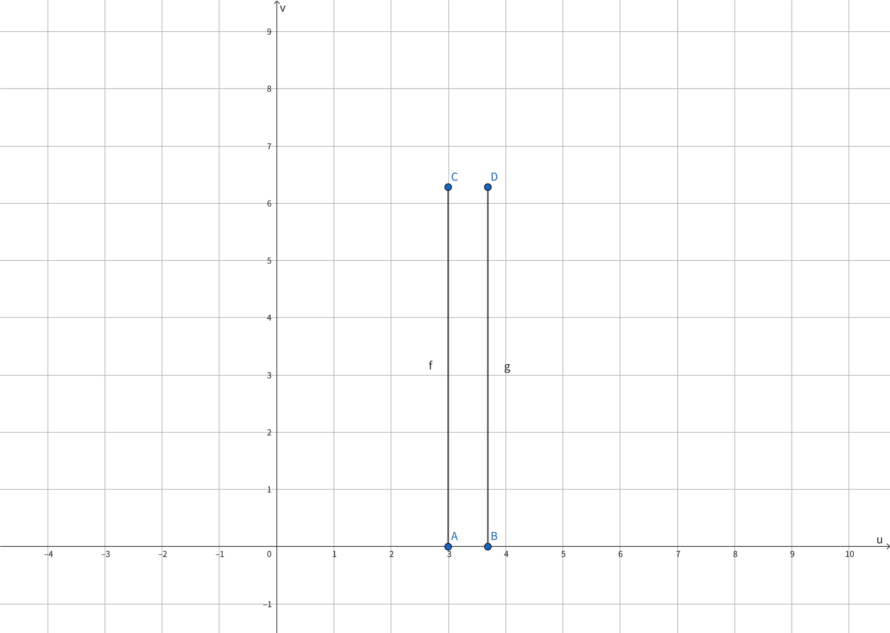
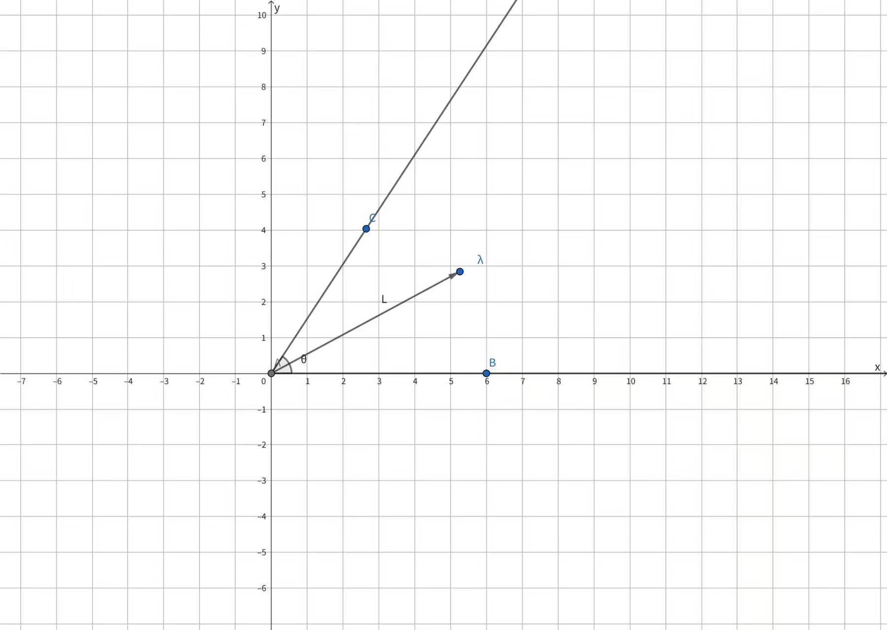
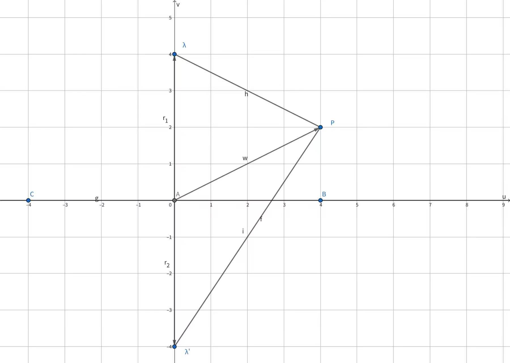

# 保角变换的简单应用

## 一、原理推导

​        本文旨在通过简单地方式阐述一下保角变换的知识，以及其在求解二维电容和电场电势分布的应用，以展示保角变换的趣味性。

​      一些前提：所有的问题都是二维平面的问题，请自动忽略$z$方向（物理上我们说$z$方向有平移对称性）。

​        如图所示，在笛卡尔坐标系下有一个圆区域，我们用$x,y$去描述这个圆的边界，就会得到圆方程$x^2+y^2=R^2$，如果我们采用极坐标系去描述，就只会写出$\rho=R$这一个方程，似乎问题变得简单了？实则并没有，虽然在极坐标下，我们描述这个圆边界确实只要很简便的一个方程，但是同时，相关的算符都发生了形式上的变化(例如：在笛卡尔坐标系下有$\nabla ^2 \varphi=\frac{\partial^2 \varphi}{\partial x^2}+\frac{\partial^2 \varphi}{\partial y^2}$，极坐标下变为$\nabla ^2 \varphi=\frac{1}{\rho}\frac{\partial }{\partial \rho}(\rho\frac{\partial \varphi}{\partial \rho})+\frac{1}{\rho ^2}\frac{\partial^2 \varphi}{\partial \theta^2}$)使得问题并没有变得简单。那如果我们更进一步，令$u=ln\rho(后面会解释为什么是ln函数)，v=\theta$，作出$u,v$系呢？经过计算研究我们发现，不但圆边界变成了一条线段，算符仍然保持了笛卡尔坐标系下的形式，就连拉普拉斯方程在电荷为零处都保持了形式不变。

​        先简单粗糙地阐述一点点复变函数的知识：同样在如图所示的系中，不过这时候我们令一个元（笔者看来像是一个向量元）$z=x+iy$，这个元对应原图中的点$(x,y)$，所谓复变函数，其实就是变量是复数的函数，即$f(z)=u(x,y)+iv(x,y)$，我们来考察一下这个函数的导数$f'(z)=\lim\limits_{\Delta z \to0} \frac{f(z+\Delta z)-f(z)}{\Delta z }$，如果是可导的，那么从任何方向逼近点$z$都应该得到同一个值，不妨取水平和竖直两个特殊的方向，由此得到$f'(z)=\frac{\partial u}{\partial x}+i\frac{\partial v}{\partial x}=\frac{\partial v}{\partial y}-i\frac{\partial u}{\partial y}$，令实部和虚部分别相等，得到**柯西黎曼条件$(C-R条件)$**：
$$
\frac{\partial u}{\partial x}=\frac{\partial v}{\partial y},\frac{\partial u}{\partial y}=-\frac{\partial v}{\partial x}
$$
​        这个条件的约束力非常强，但在这里我们先不讨论过多内容。可以证明，在一个区域$D$内，当**$u_x,u_y,v_x,v_y$都存在并且连续**时，**$f'(z)$存在**和**柯西-黎曼条件**互为**充要条件**，感兴趣的读者可以简单看一下粗略的证明，也可直接跳过下述证明，不影响阅读。
$$
\because u_x,u_y,v_x,v_y存在且连续\\
\therefore u,v是可微的\\
于是，f'(z)=\lim\limits_{\Delta z \to0} \frac{f(z+\Delta z)-f(z)}{\Delta z}\\=\lim\limits_{\Delta x \to0, \Delta y \to0} \frac{[f(z)+u_x \Delta x+ u_y\Delta y+i(v_x\Delta x+v_y\Delta y)]-f(z)}{\Delta x+i\Delta y}\\=\lim\limits_{\Delta x \to0, \Delta y \to0} \frac{u_x \Delta x+ u_y\Delta y+iv_x\Delta x+iv_y\Delta y}{\Delta x+i\Delta y}\\
由C-R条件：u_x=v_y,u_y=-v_x\\得：f'(z)=\lim\limits_{\Delta x \to0, \Delta y \to0} \frac{u_x \Delta x- v_x\Delta y+iv_x\Delta x+iu_x\Delta y}{\Delta x+i\Delta y}\\=\lim\limits_{\Delta x \to0, \Delta y \to0} \frac{(u_x+iv_x) (\Delta x+i\Delta y)}{\Delta x+i\Delta y}=u_x+iv_x=v_y-iu_y\\
即得，当 u_x,u_y,v_x,v_y存在且连续时，由C-R条件可以推出f'(z)存在
$$
​        接下来回归到我们的主题——保角变换。我们来思考这样一个问题，我们一开始设的复元是$z=x+iy$，这个元存在于$x,y$系中，如果我们想用另外的坐标系$u,v$去描述问题，我们应该设一个新的元$w=u+iv$,显然，这两个系之间的几何关系，都存在于这样一个函数关系$w=w(z)$中。在我们研究的物理情景中，一般不会出现奇异的情况（即$u_x,u_y,v_x,v_y一般都存在且连续$），所以如果$w=w(z)$这个函数满足$C-R$条件，就可以知道$w'(z)$是存在的，并且在空间中的取值是一些复数，由欧拉公式，复数总可以表示为$\rho e^{i\theta}$形式。假设在空间中**导数非零**的一点处有两个微元$dz_1,dz_2$，他们原本的夹角为$\alpha$，有$dw_1=w'(z)dz_1,dw_2=w'(z)dz_2$，复数乘法即“**模长相乘，幅角相加**”，由此可以知道，两个微元在新系中相差的角度仍然不变，依然为$\alpha$ （同时加了同一个角度，差值不变，整体一起旋转$arg(w'(z))$），这也是**保角变换**名字的由来。

​        变换$w=w(z)$满足柯西黎曼条件，我们不妨做些简单的计算来看看这个条件带来了什么奇特的物理性质：
$$
已知\frac{\partial u}{\partial x}=\frac{\partial v}{\partial y},\frac{\partial u}{\partial y}=-\frac{\partial v}{\partial x}\\
则u_xv_x=-v_yu_y\\
在原系中，高斯定理的形式是{\nabla _{xy}}^2\varphi=\varphi_{xx}+\varphi_{yy}=-\frac{\rho(z)}{\epsilon_o}\\
做一些简单运算转换为对u，v的导数:{\nabla _{xy}}^2\varphi=\varphi_{xx}+\varphi_{yy}\\=(\varphi_{u}u_x+\varphi_v v_x)_u u_x+(\varphi_{u}u_x+\varphi_v v_x)_v v_x+(\varphi_{u}u_y+\varphi_v v_y)_u u_y+(\varphi_{u}u_y+\varphi_v v_y)_v v_y\\
=\varphi_{uu}{u_x}^2+\varphi _{uv}u_xv_x+\varphi _{uv}u_xv_x+\varphi_{vv}{v_x}^2+\varphi_{uu}{u_y}^2+\varphi _{uv}u_yv_y+\varphi _{uv}u_yv_y+\varphi_{vv}{v_y}^2\\
=\varphi_{uu}({u_x}^2+{u_y}^2)+\varphi_{vv}({v_x}^2+{v_y}^2)+2\varphi_{uv}(u_xv_x+u_yv_y)\\
代入柯西黎曼条件以及导数的计算式得：\\
{\nabla _{xy}}^2\varphi=\left|w'(z)\right|^2(\varphi_{uu}+\varphi_{vv})=\left|w'(z)\right|^2{\nabla _{uv}}^2\varphi=-\frac{\rho(w)}{\epsilon_o}\\
得:{\nabla _{uv}}^2\varphi=-\frac{\rho(w)}{\left|w'(z)\right|^2\epsilon_o}
$$
​        此即我们前面所说，算符仍然保持笛卡尔坐标系形式并且拉普拉斯方程的形式也不变。

​       这个式子很好理解，我们做坐标变换，本质其实就是用不同的方式去看同一件事物，电荷当然是守恒的，但是由前所述，面元的两条边元，其实都是放大了**该处导数的模**倍（这个模，在物理上可能具有一定的量纲），所以面元放大了**导数模的平方倍**，所以电荷密度就被稀释了。但有一件事情值得关注，那就是我们的拉普拉斯方程没有发生结构变化，甚至在空间电荷为零的地方完全一致，也就是说，如果挑选一个适配的变换，能使得这个新的系下，奇怪边界如果能转换为常规的边界，那么我们就能够用我们已知的手段去解决问题了，事实证明确实如此。

## 二、简单应用

### 此处我只介绍两种有趣的应用

#### 1、关于电容

我们经常遇到关于求解二维电容的问题，一般都是体系在$z$方向无限延长，想求解单位长度上的电容。接下来我拿一个典型的例题来介绍一下：

有一根无限长的同轴导体管，管壁厚度忽略不计，内管半径为$R_1$，外管半径为$R_2$，问：单位长度的电容是多少？

这个题本身难度不高，我们常规的做法就是设内管带电线密度$\lambda$，外管为$-\lambda$，然后求解电场算出电势差，就可以得到单位长度电容：
$$
E_{(r)}=\frac{\lambda}{2\pi \epsilon_o r}\\
\therefore\Delta U=\int_{R_1}^{R_2} \frac{\lambda}{2\pi \epsilon_o r} dr=\frac{\lambda}{2\pi \epsilon_o } ln \frac{R_2}{R_1}=\frac{\lambda}{C}\\
\therefore C=\frac{2\pi \epsilon_o }{ln \frac{R_2}{R_1}}\\(此处的电容是指单位长度的电容)
$$

但是如果我们用保角变换呢？

不妨令变换$w=lnz=ln(\rho(x,y)e^{i\theta(x,y)})=ln[\rho(x,y)]+i\theta(x,y)$令$u=ln\rho,v=\theta$，则在新的$u,v$系中，边界就变成了两条线段

如图：

​        分别位于$u_1=lnR_1,u_2=lnR_2$处，从$v_1=0到v_2=2\pi$。我们只是**用另一种方式来描述同一件事情**，所以不难知道，两个边界之间的**电势差是不会变**的，各边界**所带的总电荷是不会变**的（哪怕因为坐标量纲和数值的变化会导致电荷“密度”的量纲和数值变化，但是总电荷一定是不变的。即几何量和对应密度之乘积一定保持了量纲和数值），所以电容也没有变。

​        刚才已经说明了，定义为$\frac{Q}{\Delta U}$的电容不会发生改变，所以我们在新的系下求出来的电容就是原系下的电容。我们回到公式${\nabla _{uv}}^2\varphi=-\frac{\rho(w)}{\left|w'(z)\right|^2\epsilon_o}$，可以知道，当电荷密度转换完之后，我们在新系下求解电场问题和在原系下没有任何区别，满足同样的方程（唯一的区别就是新系下电荷体密度和空间的体积元的量纲可能发生了变化，但是这完全不影响我们的计算，可以多思考一下这一点）。所以我们可以直接这样计算：
$$
C=\frac{\epsilon_o l}{d}，（原本是C=\frac{\epsilon_o S}{d}，但现在是二维的电容）\\
\therefore 代入得：C=\frac{\epsilon_o\Delta v}{\Delta u}=\frac{\epsilon_o 2\pi  }{ln {R_2}-ln{R_1}}=\frac{2\pi \epsilon_o }{ln \frac{R_2}{R_1}}
$$
很神奇！通过掌握不同形式的保角变换，适配不同的边界形状，我们总可以把未知转为已知！

#### 2、关于电势分布的求解

同样的，在这里我用一个具体的例子来阐述如何利用保角变换来方便的求解电势的分布。

如图所示，导体边界是墙角形状，夹角为$\theta$，在其角平分线上距离交点$L$处，有一根带线电荷密度为$\lambda$的绝缘带电线，已知导体电势为0，求解电势在空间中的分布函数。

关于这个问题，如果$\theta$为一些特殊的角度，例如$60^o,90^o,120^o$之类的，我们可以通过电像法的技巧来解决，但是问题没这么轻松，此处$\theta$并不是某个特殊的角度。如果用电像法，会需要画无数个电像，这显然不是一个明智的做法。

用保角变换或许会是一个不错的选择：

$$
如图，我们做变换w=z^{\frac{\pi}{\theta}}=(re^{i\alpha})^{\frac{\pi}{\theta}}=r^{\frac{\pi}{\theta}}e^{i\frac{\alpha}{\theta}\pi}\\
这里我们依然令其实部和虚部分别为新的坐标，但是用极坐标形式帮助我们刻画边界\\
（注意，此刻原点O是不保角的，请自己思考为什么）\\
于是可以发现，原本位于\alpha=\theta处的边界变成了\alpha=\pi，总边界变成了一个平面\\
我们前面已经多次说明，在新系下求解电场问题，和原先几乎并无区别\\
电荷线密度由于与我们平面面元无关，所以没有变化仍然为\lambda，我们在此处采用电像法\\
此时带电体的位置变为：w_o=z_o^{\frac{\pi}{\theta}}=(Le^{i\frac{\theta}{2}})^{\frac{\pi}{\theta}}=L^{\frac{\pi}{\theta}}i,即位于虚轴上，距离O点L^{\frac{\pi}{\theta}}处。\\
所以像电位于负虚轴上对称的位置，带电量为原电的负值。\\
于是正半空间中任意一点w的电势\varphi_{(w)}=\frac{\lambda}{2\pi \epsilon_o}(ln\left|w+L^{\frac{\pi}{\theta}}i\right|-ln\left|w-L^{\frac{\pi}{\theta}}i\right|)\\=\frac{\lambda}{2\pi \epsilon_o} ln\left|\frac{w+L^{\frac{\pi}{\theta}}i}{w-L^{\frac{\pi}{\theta}}i}\right|(类似向量)\\
逆变换回去即可得原系下的电势分布：\\
\varphi_{(z)}=\frac{\lambda}{2\pi \epsilon_o} ln\left|\frac{z^{\frac{\pi}{\theta}}+L^{\frac{\pi}{\theta}}i}{z^{\frac{\pi}{\theta}}-L^{\frac{\pi}{\theta}}i}\right|\\
于是问题得以解决
$$
至此，关于保角变换的两种趣味应用就已经全部介绍完毕。